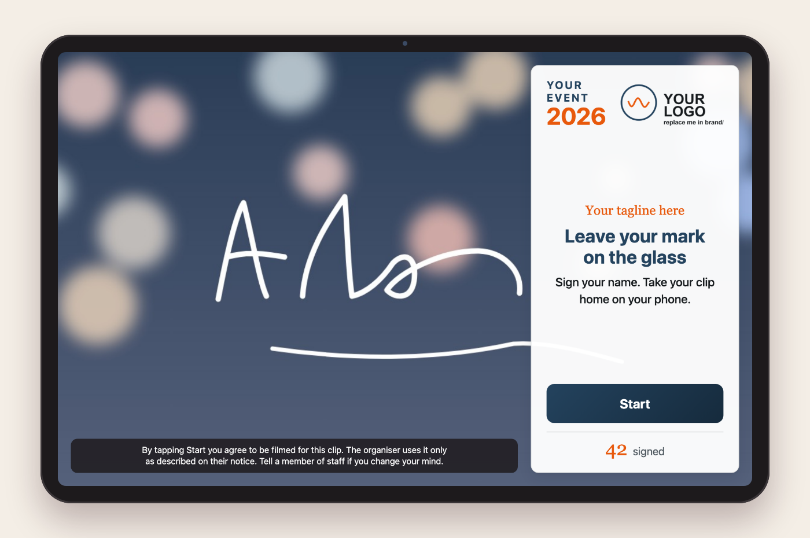
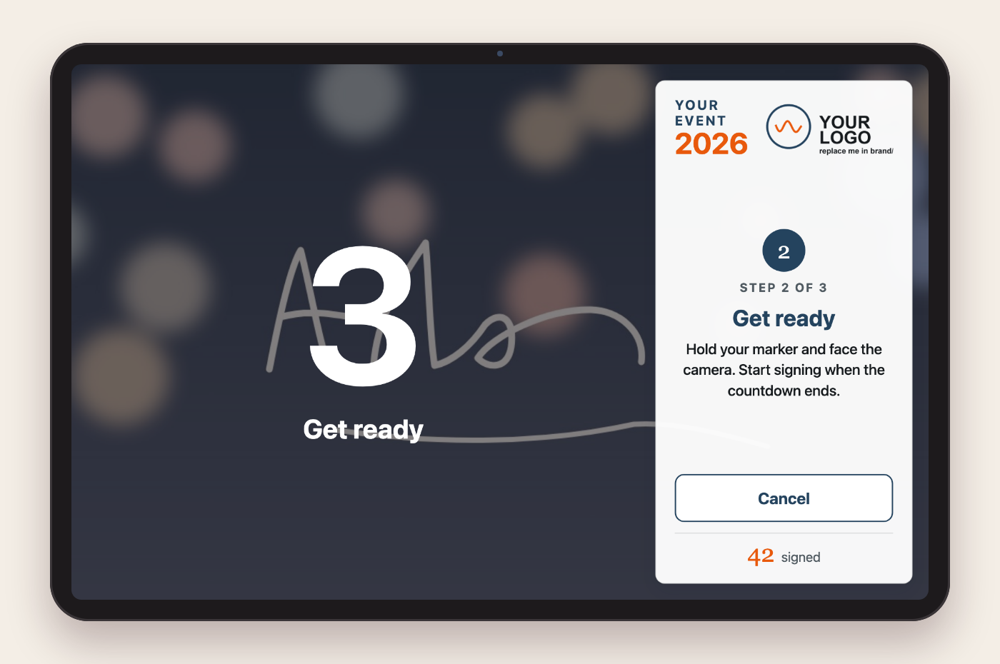
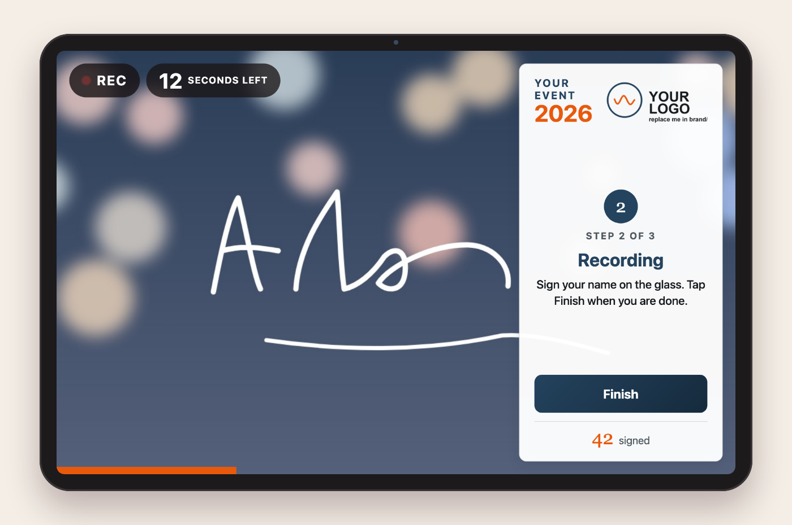
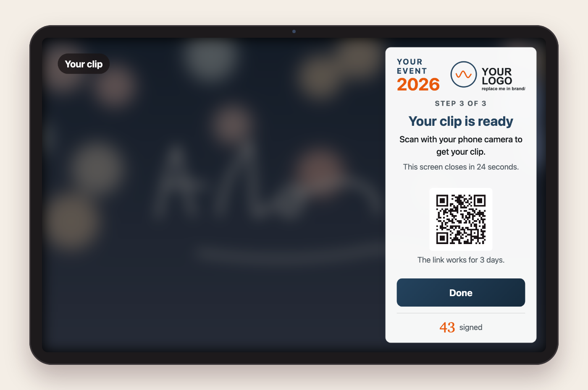
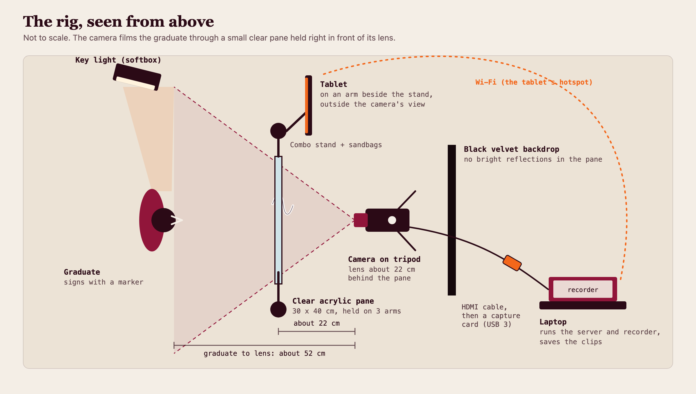
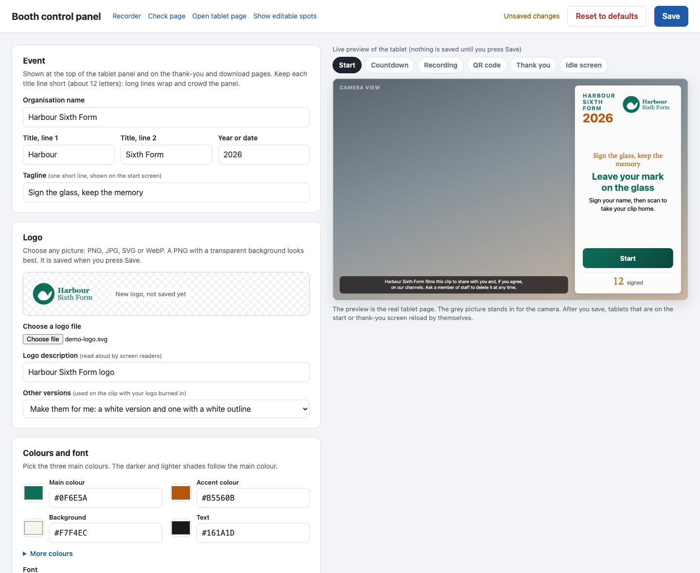
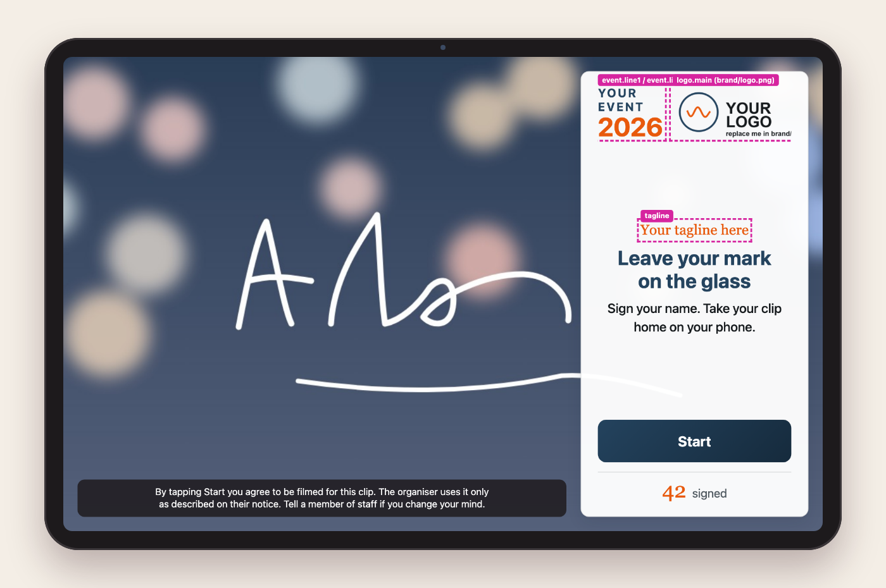

# Sign-Off Booth

A small program for filming short sign-off clips. A graduate (or anyone leaving a mark at an event) writes their name on a clear acrylic pane. A camera on the other side films them through it. A tablet next to the pane tells them what to do. When they finish, they scan a QR code and get the clip on their phone.

It runs on one laptop. It has no accounts, no cloud service you must use, and no packages to install apart from Node.js.

**New here? Follow the [Quick start](QUICKSTART.md): download to a working test recording in about 10 minutes.** The exact kit used to build the booth is in [EQUIPMENT.md](EQUIPMENT.md).



A short illustrated guide with the same pictures is in [SignOffBooth-program-and-guide.pdf](SignOffBooth-program-and-guide.pdf).

## What it does

- The **tablet** shows the steps: Start, countdown, recording, done.
- The **recorder** page (on the laptop) takes the camera picture, records the clip, and saves it.
- Each clip is saved twice: a clean master, and a copy with your logo added for the graduate.
- A **share page** on the laptop gives the graduate a download link. The tablet shows it as a QR code.
- A **control panel** (on the laptop) lets you change the logo, title, colours, font, wording, consent text, countdown and recording length, with a live preview of the tablet. No code, no file editing.
- A **check page** tells you before the event whether the camera, disk space, network and consent wording are ready.
- An optional **promo video** plays on the tablet when nobody has touched it for a while.

| | | |
|---|---|---|
|  |  |  |
| Countdown | Recording | Clip ready, QR code |

## The rig



The booth was built and tested with this arrangement. Everything is swappable; the full list with model names, what each part does, and what is optional is in **[EQUIPMENT.md](EQUIPMENT.md)**.

The idea: a **small clear acrylic pane (30 x 40 cm)** is held on arms, right in front of the camera lens (about 22 cm). The graduate stands about 52 cm from the lens and writes on the pane with a marker. The camera films their face and the writing through the pane. Because the camera sees the writing from behind, the program flips the picture so it reads correctly.

What is in it, in short:

- **Camera** that sends a clean picture over HDMI (a Sony ZV-E10 here), on a tripod, running on a dummy battery so it stays on mains power. Any camera with clean HDMI out, or a good webcam, works.
- **Capture card**, HDMI to USB 3 (a UGREEN 4K60 card here). It should say USB 3.0 and 1080p and show up as a normal camera. Avoid USB 2.0 dongles: they squeeze the picture.
- **Clear acrylic pane** 30 x 40 cm, 4 mm, held by three arms on two light stands, with foam pads on the edges and sandbags on the feet.
- **Tablet** (a Samsung Galaxy Tab S8 Ultra here) on its own arm beside a stand, outside the camera's view. Any tablet with a browser works.
- **Laptop** with Chrome or Chromium and Node.js 18 or newer. macOS and Linux are supported by the launchers.
- **Soft key light** aimed at the person and not at the pane, and a **black cloth** behind the camera so nothing bright reflects in the pane.
- **Wi-Fi** that the laptop and tablet both join. A phone or tablet hotspot works. Guests' phones need to reach the laptop too, unless you host the share page elsewhere (see "Share link").
- **Markers, glass cleaner, cloths** for between people.

## Set up

1. Install [Node.js](https://nodejs.org) (LTS, 18 or newer) and Google Chrome (or Chromium).
2. Download this folder.
3. Start it.
   - **macOS:** double-click `Start Booth.command`. If macOS refuses, right-click it, choose Open, and confirm once.
   - **Linux:** run `bash "Start Booth (Linux).sh"` from a terminal, or make it executable and double-click.
   - Keep the terminal window open for the whole event. Closing it stops the booth.
4. The **check page** opens in Chrome. Go through its list. Click through to the **recorder**.
5. Make it yours: open the **control panel** (the check page has a link, or go to `http://localhost:8080/control` on the laptop) and set your logo, title, colours and wording. See "Make it yours".
6. In the recorder, open **Settings**:
   - pick your **Camera** and allow camera access when Chrome asks;
   - choose **Where clips are saved** (this laptop, another folder, a Google Drive for desktop folder; plus an optional backup to a USB stick);
   - write your **consent line** (see "Consent and privacy").
7. The recorder shows a QR code under **Connect the tablet**. Scan it with the tablet, or open the address it shows. Keep the tablet in full screen.

Settings you save go to `booth-settings.json`. The default port is 8080; change it under `launcher` if something else uses it.

### Linux and Google Drive (optional)

There is no Google Drive app for Linux, so the booth can copy clips to Drive with [rclone](https://rclone.org):

1. Install rclone.
2. **Make your own Google client first.** In Google Cloud Console, create a project, enable the Drive API, and create an OAuth client ID (type "Desktop app"). Keep the client ID and secret private.
3. Run `rclone config`, add a remote called `boothdrive`, and paste your client ID and secret when it asks. Then sign in.
4. The Linux launcher turns on `storage.sync` for you the first time. You can also set it by hand:

```json
"sync": { "type": "rclone", "remote": "boothdrive:", "path": "" }
```

Why step 2 matters: see failure point 3 below.

## On the day

Before people arrive:

1. Start the booth and open the check page. Fix anything that is red.
2. Do two test clips. Watch each one back. Check the writing reads correctly, the picture is sharp, the face is lit, and remember that clips are silent (the recorder does not use a microphone).
3. Clean the glass. Put the markers out.
4. Make sure the laptop is on charge and the camera is on mains power.
5. Tell the person who runs the booth what to do if something fails (see below).

While running:

- The tablet leads the person through Start, countdown, recording, and the QR.
- Someone should stand by to wipe the glass between people and help with phones.
- Glance at the recorder now and then. It shows saved clips, performance, and any warning.

When you finish:

- Stop the booth by closing its terminal window.
- Copy the clips folder somewhere safe. Clips live in the folder you chose, under `Masters` (clean) and `Share` (with logo). `booth-log.csv` lists file names, sizes and times only.
- Delete clips you do not need to keep. See "Consent and privacy".

## Make it yours

### The control panel (no code)

Open `http://localhost:8080/control` in Chrome **on the booth laptop** (the check page and the recorder both link to it). It does not open from other devices, on purpose: there are no accounts, so the panel is limited to the laptop itself.



On the left you can change:

- **Event:** organisation name, the two title lines, year, tagline.
- **Logo:** pick any PNG, JPG, SVG or WebP. The panel converts it to PNG and, if you wish, makes the white version and the outlined version for you. Files over 2 MB after conversion are refused.
- **Colours and font:** main colour, accent, background and text colour with colour pickers (the darker and lighter shades follow the main colour), and a choice of five fonts that are already on every computer. The panel warns you if the text would be hard to read.
- **Wording:** the start, thank-you and idle screens, who to ask for help, and the download page your guests see on their phones.
- **Consent text.**
- **Recording:** countdown (0 to 10 s) and longest clip (5 to 60 s).
- **Sharing:** how long the link works, how long the QR and thank-you screens stay, and an optional address to host the share page elsewhere.

On the right is the **real tablet page**, driven by what you type. Use the buttons above it to look at each screen. Nothing is saved until you press **Save**. Tablets on the start or thank-you screen then reload by themselves.

**Reset to defaults** puts back the standard logo, colours, wording and timings. Your previous branding is kept in `brand/brand.previous.json`.

### What it writes

The panel saves to [`brand/brand.json`](brand/brand.json) (look and wording), to PNG files in `brand/` (logos), and to `booth-settings.json` (timings and consent). You can still edit `brand.json` by hand; reload the tablet to see it. No restart either way.

To see which parts of a page come from that file, add `?marks=1` to its address, for example `http://localhost:8080/tablet?k=KEY&marks=1`. Each spot you can change gets a dashed outline and a label with the setting's name. The control panel has a **Show editable spots** link for this.



- **Logos:** four versions are used: `logo.png` (main), `logo-border.png` (with a white outline, for busy footage), `logo-light.png` (white, for dark footage), `logo-colour.png` (full colour). The control panel writes all four. To do it by hand, replace the PNG files in `brand/` (same names, or change the names in `brand.json`). Transparent PNGs work best.
- **Fonts:** the control panel offers system fonts. To use your own, put the font files in `brand/`, write a small CSS file that points at them as `/brand/<name>`, and name it under `fonts.cssFile`.
- **Promo video:** put `promo.mp4` in `brand/` (not included). It plays on the tablet when nobody has touched it for a while.
- **Share link:** by default the link points at the laptop (`/share/<code>`), so a phone must be on the same network. To host the share page elsewhere, set the share address in the control panel (or `shareBase`).

The panel only changes how the booth looks and the main timings. The camera, save location, backup, retakes and the other timings are in the recorder's **Settings**.

## Three things that went wrong in practice

These cost time at a real event. Check them in your rehearsal.

1. **The camera was left in photo mode.** The picture was 3:2 with black bars at the sides, not 16:9. Put the camera in **video mode** and confirm the recorder's Performance card shows a 16:9 size such as 1920 x 1080.
2. **The camera ran at 25 fps while the recorder asked for 30.** Some cameras follow a PAL or NTSC setting and send 25 or 30 whatever you ask. The recorder asks the camera for 30 fps; it cannot force it. Look at the Performance card to see what the camera really sends. Set the camera to 30 fps (often a PAL / NTSC or system frequency setting) so the two agree. A mismatch can make clips stutter.
3. **Upload quota ran out.** rclone's built-in Google client is shared by every rclone user, so Google's limits are hit quickly and uploads fail with quota errors. Create **your own Google OAuth client** (see "Linux and Google Drive") and use it in `rclone config`. Clips stay safe on the laptop meanwhile, but the graduate's link will not work until the upload goes through.

## Consent and privacy

This program films people and gives them a link. That is personal data in most places. **You are the organiser, so you are responsible for how you use it.** What follows is plain guidance, not legal advice.

- **Write your own consent wording.** The file ships with a placeholder (`[EDIT ME]`) and the check page warns you until you replace it. Say who films, what the clip is used for, how long you keep it, and who to tell if someone changes their mind. Show it on the tablet (`consent` in `brand/brand.json` or the recorder's Settings) and, if possible, on a sign next to the booth too.
- **Check the law where you are.** For example, in Singapore the Personal Data Protection Act (PDPA) applies; in the EU and UK, GDPR (or UK GDPR). They have rules on consent, purpose, how long you keep data, and access and deletion requests. A clip with a face or a name is personal data.
- **Children and minors** need extra care and usually a guardian's consent. Do not run the booth for minors unless you have that sorted.
- **Collect only what you need.** The program does not ask for names, emails or phone numbers (the person's handwriting on the glass is the only name in the clip). The share link uses a random code, not a name. Do not add details to the file names.
- **Where the data goes.** Clips are saved in the folder you choose. If that folder syncs to Google Drive, Google also holds them. The share page runs on your laptop. The program sends nothing to the author or any analytics service. The one outside call is the check page asking `www.google.com` for a tiny empty reply to test that the internet works.
- **Keep and delete.** Decide how long to keep clips and delete them when that is up. The download link stops working after `linkHours` (72 by default); the files stay until you delete them.
- **Be able to remove a clip** when someone asks. Each clip has a code in its file name.

## Files in this folder

```
Start Booth.command           macOS launcher
Start Booth (Linux).sh        Linux launcher
booth-settings.json           settings the recorder saves (port, storage, timings)
QUICKSTART.md, EQUIPMENT.md   10-minute start guide; the kit list
app/                          the server, recorder, tablet, control panel and check pages
                              (app/brand-defaults holds the standard look, used by Reset)
brand/                        brand.json, logos (written by the control panel)
docs/                         screenshots, rig drawing, and the sources for the PDF
LICENSE, THIRD-PARTY.md       MIT licence; what else is involved
```

## Known limits

- It records with the browser, so it needs Chrome or Chromium, and a camera the browser can see.
- It runs one booth per laptop.
- The sound cues play on the tablet.
- There are launchers for macOS and Linux; Windows has none yet (you can run `node app/booth-server.js` yourself).

## Licence

MIT. See [LICENSE](LICENSE). Other software the booth works with is listed in [THIRD-PARTY.md](THIRD-PARTY.md).
